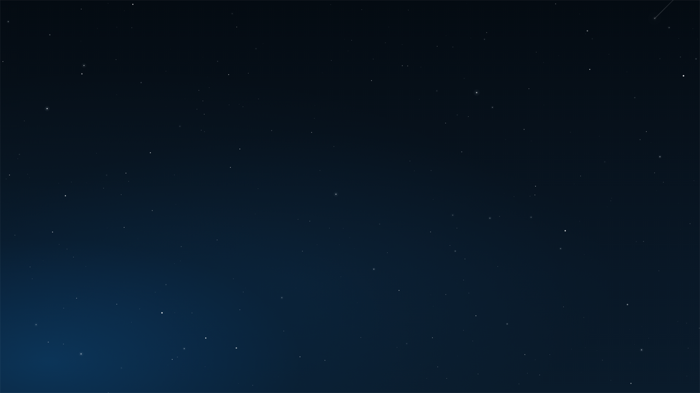

<h1 align="center">
  <picture>
    <source media="(prefers-color-scheme: dark)" srcset="docs/images/banner-dark.svg">
    
  </picture>
</h1>

<b>A full-screen night sky that twinkles and shoots stars, in a single HTML file.</b> Add <code>index.html</code> as a web wallpaper in Lively, or open it in any browser.

[Install](#install) · [Customize](#customize) · [Spicetify theme files](#spicetify-theme-files) · [Known limits](#known-limits) · [License](#license)

  

## At a glance

| | |
|---|---|
| **Does** | Draws a random star field on a dark blue gradient, twinkles it, and sends shooting stars across it |
| **Runs in** | A browser engine; meant for [Lively Wallpaper](https://livelywallpaper.net) |
| **Needs** | Nothing: no build step, no dependencies, no network |
| **Status** | Renders in Chromium (checked with headless Edge); see [Status](#status) |

## Features

| | |
|---|---|
| **Star dust** | A canvas layer with one star per roughly 6,500 square pixels of window area. About 85% are tiny, about 18% get a soft halo, and each one twinkles slowly. |
| **Shooting stars** | Twelve CSS-animated shooting stars, each with its own delay (0 to 7.4 s) and duration (2 to 3.1 s), looping forever. |
| **Night gradient** | A dark blue background with a faint glow in the lower left. |
| **Redraws on resize** | The star field is generated again when the window size changes. |
| **Sharp on high-DPI screens** | The canvas uses up to twice the device pixel ratio. |
| **Reduced motion** | With the system setting "reduce motion" on, the shooting stars are hidden. |

## Install

1. Download or clone this repository.
2. Drag `index.html` into the Lively window. Lively renders web pages with a Chromium-based engine and sets a dropped web page as a wallpaper (this is how Lively's own documentation describes it; not run here).
3. To try it without Lively, open `index.html` in a browser.

## Customize

Everything is in [`index.html`](index.html). Edit the file and reload.

| To change | Where |
|---|---|
| Star density | `const count = Math.floor(area / 6500);` A smaller divisor means more stars and more drawing work per frame. |
| Share of stars with a halo | `Math.random() < 0.18` in `initParticles` |
| Colors | `body` background (`#07111c`) and the gradients in `.glow-background` |
| Shooting star count, position and timing | The twelve `` elements in `.star-field` and the matching `.star-field span:nth-child(n)` rules |

## Spicetify theme files

The repository also holds three files that look like a Spicetify theme for the Spotify desktop app: `color.ini`, `user.css` and `theme.js`. `theme.js` adds a star layer and four shooting stars behind Spotify's main container and keeps the now-playing bar as wide as the right sidebar; `user.css` styles Spotify's interface.

How to try them

Spicetify themes usually live in a folder under Spicetify's `Themes` directory. Put the three files in one, select the theme with `spicetify config current_theme <folder name>`, and run `spicetify apply`. See the Spicetify documentation for the details of your version. These steps follow Spicetify's usual layout and were not run for this README.

## Security and privacy

`index.html` makes no network requests and stores nothing. `theme.js` reads one value from Spotify's local storage (the saved width of the right panel); nothing is sent anywhere.

## Known limits

* Not checked inside Lively. Only the page itself was rendered, in Chromium.
* The star positions are random, so every load looks different.
* The Spicetify files use color variables that `color.ini` does not define: `star`, `star-glow`, `shooting-star`, `shooting-star-glow`, `highlight` and `sidebar-alt`. Define them before relying on the theme; without them the stars may not be visible.
* The page comments and the page language attribute are Turkish.

## Status

Checked on 2026-11-06: the page renders in headless Microsoft Edge (screenshot above), and the inline script and `theme.js` pass a JavaScript syntax check. The Spicetify files and Lively itself were not run. There are no automated tests and no versioned releases yet.

## Credits

The shooting-star animation is based on "Pure CSS Shooting Star Animation Effect" by Delroy Prithvi (MIT license). The copyright and permission notice is kept in `theme.js` and `user.css`.

## License

MIT, see [LICENSE](LICENSE).
